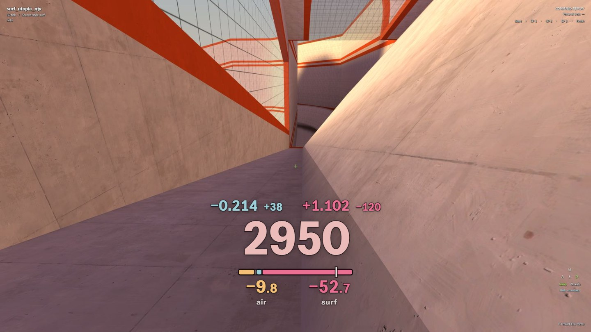
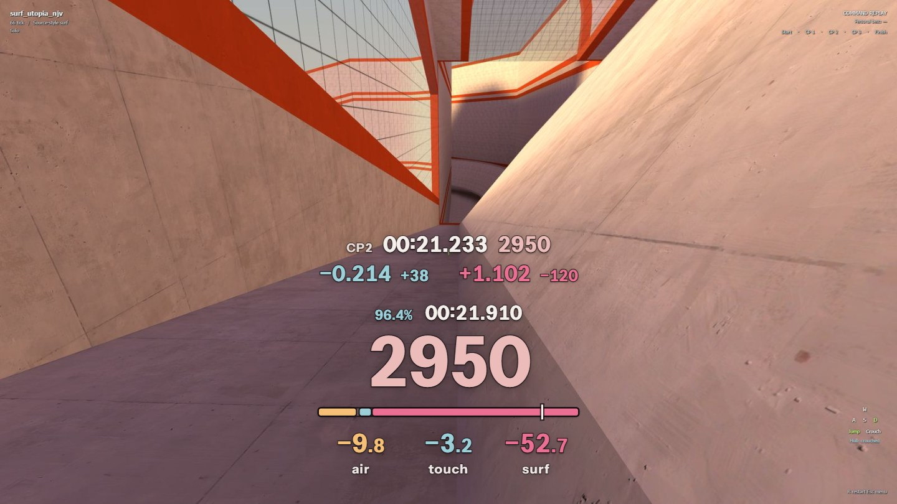
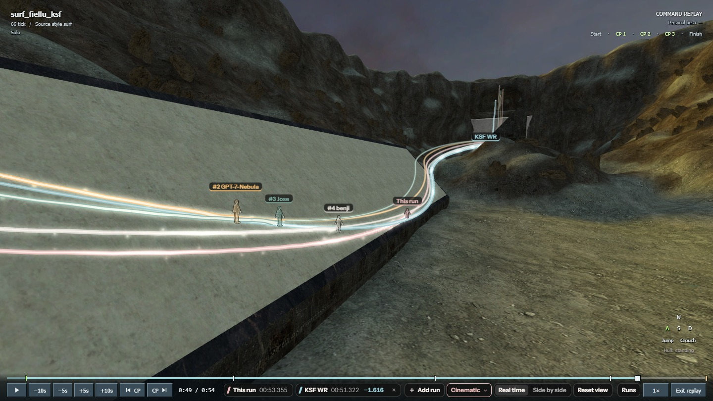

# Surfd QoL



*The compact HUD you surf with, just after a checkpoint. Replays and spectating show everything, and each part can be shown or hidden on its own.*

A browser extension for [surfd.net](https://surfd.net/) that shows where you lose speed, on each ramp and in the air, so you can find your mistakes and see what an optimal run does differently. It also adds start stats, PB and WR checkpoint splits, run history with ramp stats, cinematic replays with other runs alongside, community rooms, a crouch-jump bind, nullbinds and faster map loading.

Everything on the HUD can be configured or turned off. Movement, collision, maps and your runs stay exactly as the game makes them: the feedback watches the game's own movement code and reports what happened.

**Download page: [eduardr02.github.io/surfd-qol](https://eduardr02.github.io/surfd-qol/)**

## Install

You need a desktop Chromium browser: Chrome 118 or newer, Edge, Brave or Opera (Firefox isn't supported). The extension isn't on the Chrome Web Store, so you load it yourself:

1. Download [surfd-qol.zip](https://github.com/EduardR02/surfd-qol/releases/latest/download/surfd-qol.zip) and unzip it somewhere it can stay. Your browser loads the extension from that folder every time.
2. Open your browser's extensions page (`chrome://extensions`, `edge://extensions`, `brave://extensions` or `opera://extensions`) and switch on **Developer mode**.
3. Click **Load unpacked** and pick the unzipped folder (the one containing `manifest.json`).
4. Open [surfd.net](https://surfd.net/). The tab reloads once while the extension hooks in. Settings are under **QoL**, bottom right of the game menu, next to the notification bell. Changes save automatically.

**Updating:** checks run when you open Surfd and hourly while it stays open. When a new version is out, a link to the download page appears above **QoL** in the game menu. Download the new zip, replace the folder's contents, click the reload icon on the extension in your browser's extensions page, then reload Surfd. Your settings stay.

### About the "started debugging this browser" bar

Your browser shows this bar because the extension uses the debugger permission to patch the game script as it loads. That's the only way to reach the game's physics. It only attaches to surfd.net's game page and only touches the game's own scripts.

You can close the bar with × or **Cancel**. Everything already loaded keeps working until you reload the page. The toolbar badge shows **ON** when the extension is active and **!** if setup failed or the bar was closed too early. Click the toolbar button to reconnect; that reloads the tab, so do it between runs. The bar comes back after each reload.

## The HUD

Speed sits big in the middle of the screen, with a bar for your last ramp under it. Size, height, opacity and colors are all adjustable. The HUD hides in menus and loading screens and stays up for replays and spectating.

**Two layouts.** While you surf, the HUD stays compact: the speed, the ramp bar and two values under it. For a few seconds after the start and each checkpoint, your start stats or checkpoint deltas show above the speed. Replays and spectating show the full HUD: timer, strafe sync, each checkpoint's split and every ramp value. Under **QoL → Display** you can keep the full HUD on while you surf, add the timer, turn off the value labels, or pick **Zen** for just the speed and start stats.

**The ramp bar** shows your last flight (AIR) and the ramp you landed on, in the order they happened, each part in the color of its grade. The tick marks where the ramp would have ended had it cost what the reference ramp did, so anything right of it is what you lost beyond the reference. The two values under the bar are the flight's loss and what the ramp has cost so far: its touch right after you land, then the whole ramp once you leave it.

The values, all in u/s. Each stays until the next ramp or flight replaces it, so you can read it in the air.

| Value | What it measures |
|---|---|
| **TOUCH** | Full 3D speed clipped off when you land on a ramp. Height conversion doesn't count. |
| **DOWN** | What the ramp cost on the way down, from the touch (included) to the lowest point. |
| **UP** | What it cost from the lowest point to where you left the ramp. |
| **AIR** | Your last flight: horizontal speed lost to braking plus gain missed by imperfect strafes. |
| **SURF** | The whole ramp, touch included: Down + Up. |

Down and Up include vertical speed and account for height, so climbing a ramp never counts as a loss. **Net Surf** is the default; choose **Down + Up** under **QoL → Feedback → Show as** to split it.

Don't chase zero: surfing usually bleeds some speed, and even the KSF record loses 34 u/s going down Cannonball's second ramp. That's why the default compares you against a reference run.

### Colors

Touch and the ramp values compare against the same ramp in a reference run, your PB or the WR:

- **teal**: as good as the reference or better
- **gold**: worse, but within the near-reference margin (2 u/s by default)
- **red**: worse than that
- **grey**: no matching data (reference still loading, a different route, or no PB on this map)

"WR" means the current course's published KSF record route by default, including bonuses, or Surfd's leaderboard #1 if selected. An unavailable KSF route leaves comparisons empty; it never falls back to the main course or leaderboard. You can also grade any value against fixed cutoffs. Air defaults to WR and compares the same flight. A worse number is a measurement, not proof of a mistake: a different line or entry speed changes it too.

### Start and checkpoints

For 1.8 seconds after you leave the start zone you see your exit **horizontal speed** (350 is the airborne cap, 325 grounded; current-rule boosted starts are uncapped), your **height** above the start platform (lower is better) and your strafe sync. Grade them against fixed targets, your PB or the WR.

At each checkpoint you get time and horizontal speed deltas against your PB, the WR or both. The reference comes from the full replay, never per-checkpoint bests.



*The full HUD, as replays and spectating show it, just after a checkpoint.*

## Binds

Both are off by default; turn them on under **QoL → Controls**.

- **Crouch-jump:** holding jump presses crouch for exactly one physics tick per jump, enough for the crouched jump impulse without staying crouched. Uses Space unless you rebind it.
- **Nullbinds:** for left/right and for forward/jump, the newest key you press wins, and releasing it hands control back to the other one if it's still held. They follow your Surfd key bindings. Forward/jump cuts forward input, not your momentum.

Both work inside the game's own input sampling, so your replay records exactly what a keyboard doing this in hardware would produce. Your Surfd binds aren't changed.

## Strafe preview

Not sure how fast to turn? Stand still in the start zone, open **QoL → Controls**, enter a speed, pick **Ground** (the prestrafe) or **Air** and press **Start**. Your view turns the way a good strafe would, at the best turn rate for that speed, and the HUD shows which of A or D you'd hold. Any key, click or mouse movement stops it and puts your view back. It only moves the camera.

## Run history

**Runs**, next to **QoL** in the menu, opens on the map you're on; pick another map from the title.

- **Runs:** your leaderboard PB (or best recorded finish), start speed stats, attempt and finish counts, best checkpoint times, your latest attempt and recent runs, each with a replay. **Recent best** keeps your fastest finish from the last 24 hours.
- **Ramps:** one row per ramp, showing how often you reach it and one measurement against your PB or the WR, so the costliest ramps stand out. Pick the measurement (Surf, Touch, Angle, Down, Up, speed in or out) and whether to show your best, your last 10 or your average. Click a ramp for the details, including the touch **angle** (how far your landing was from parallel to the ramp; 0° loses no speed), and buttons to watch that ramp in your PB, the WR or your recent best.

Runs that crash into a ramp's edge or a wall are left out of its averages, and an open ramp says how many. Practice and invalid runs don't count. **Reset averages** clears averages without touching bests or replays.

Under **QoL → History** you can turn recording off, choose how many recent runs to keep per map and set the minimum reset length. Your best finish, splits and ramp bests stay when older runs are removed. Everything is stored in this browser; the same page shows storage use and has **Clear all**.

When a run is removed by history limits or a successful clear, its pending replay trimming and compression stop at the next processing boundary.

## Replays

▶ in Runs plays a recording with the full HUD. Surfd's own player handles playback, seeking and indexing for your recordings, leaderboard runs, the record route and server replays.

The replay bar marks each ramp touch on the timeline in the color of its grade, on your own runs and on any other replay once the game has indexed it. **Saveloc** (or your usual save bind) bookmarks a moment; your saved moments become practice savelocs when you leave the replay, so you can try the section yourself. **Restart current stage** also works after you load a practice saveloc or visit a practice station. The custom replay bar is on by default; switch to Surfd's own bar under **QoL → History**. Both have the same marks and savelocs.

After you seek to a part you haven't watched yet, feedback can stay grey until the next ramp or flight, because the extension hasn't analysed what came before.

Replays also show a **Hull: crouched / standing** line in the key display. Spectating shows speed, time and checkpoint progress only, since network updates don't carry enough data for exact feedback.

### Cinematic replays

The view menu on the replay bar switches between **POV** (the player's own view), **Steady** and **Cinematic**. **Add run** puts other runs in the same replay as ghosts: your PB, your recent best, the site WR, the current course's published KSF WR (including bonuses), or any leaderboard run.



*The Fiellu record with four more runs added, in Cinematic. Each chip shows that run's gap to the one you're watching.*

- **Chips:** each run gets a chip in its color. Click one to follow that run, click it again to frame everyone, × removes it. Its gap shows whether it got to this point sooner (teal) or later (red).
- **Real time** (the default) starts each run's clock when it leaves the start zone. **Side by side** keeps the runs at the same place on the route instead, to show where the lines differ.
- **Cameras:** both plan ahead along the route, look onto the face of the ramp being surfed and steer around walls. **Steady** holds one view from the side; **Cinematic** varies it along the route. **Drag** to look around, **scroll** to zoom, double-click to go back to the planned camera.
- **Trails:** each ghost leaves a fading trail of light, and a thin line marks the route still to come. Pausing freezes them and seeking restores them.

With other runs added in Steady or Cinematic, the watched run's touch marks and Saveloc are hidden. Each added run costs some performance, so remove runs if playback gets slow.

Leaving a replay cancels cinematic preparation and releases its view resources, even before the first camera preview is ready. Removing a pending added run also releases its worker recording, including one that finished before joining the view.

## Community rooms

Surf with friends in a room of your own: no time limit, no map votes, and the host picks the map. Everyone in the room needs Surfd QoL.

- **Host:** open **Find a server** and click **Host a room**. Pick a map, a name, a player limit, and **Public** (listed under **Community** for everyone with the extension) or **Private** (room code or invite link only). Hosting needs a surfd.net account. Your browser runs the room, so keep the tab open.
- **Join:** pick a room under **Community**, type its code above the list, or open an invite link.
- **In the room:** chat, spectating, map changes and finished runs work like on Surfd's servers, and runs count for the leaderboard as in solo play, since Surfd checks each replay itself. As on Surfd's servers, everyone can play the map's bonuses (**/b**), the player list shows who is on which bonus, and each bonus keeps its own room record. Savelocs are shared: everyone sees everyone's, and each player keeps up to 20 per map, as in the game.
- **Differences from Surfd's servers:** Surfd's **Invite** button and friend status don't work for rooms yet, so share the code or link. Reports, votes and official moderation are hidden; the host can kick, ban for an hour and change the map.

Game traffic goes through Cloudflare's relay, so players never see each other's IP addresses.

## Faster map loading

Maps still preload behind the menu; geometry parsing runs off-thread and preparation yields between stages to reduce UI freezes.

Getting back into a map you've played recently is much faster than in the native game, with the same textures, collision and physics. The [download page](https://eduardr02.github.io/surfd-qol/) has the measured times. To make that possible, Surfd QoL keeps prepared collision data for the maps you played most recently in the browser, up to 256 MB in total, which Chrome stores compressed on disk (about 17 MB for the largest maps). It's part of surfd.net's site data, so clearing that removes it, and the next load rebuilds it.

## Optional extras

- **Live feedback** (off by default): a row of continuously updating values instead of the ramp bar. Meant for watching replays.
- **Tint speed by energy** (on by default): the speed number turns red while you lose energy, counting horizontal and vertical speed and height together, so only strafe gains, braking, clips and friction count. Ramps are excluded unless you turn on **Include ramps**. **Instant** is on by default and shows changes between sampled ticks instead of a short average.

## Is it safe for ranked runs?

The extension doesn't change physics, collision, timing or replays, and it doesn't submit anything. The binds change which keys count as pressed, just like keyboard software would; the result is recorded in your replay as normal input. Whether the leaderboard accepts runs made with binds is up to Surfd; see [Surfd's terms](https://surfd.net/terms.html).

## Performance and privacy

- Hidden feedback skips its analysis, and features you don't use don't run at all.
- The speed counter updates at 60 FPS and the timer at 30 FPS by default, so digits stay readable. The game itself stays uncapped.
- No telemetry. Settings, recordings and map data stay in your browser. The extension downloads reference replays from surfd.net and checks GitHub for updates at most once a day, without sending your runs or settings.
- Community rooms use a small room service on Cloudflare, only while the main menu or **Find a server** is open, while you host, or while you're in a room.

## Troubleshooting

- **No custom HUD:** check the badge. **!** means setup failed; click the toolbar button to reload. If Surfd shipped an update the extension doesn't recognise, it stays out of the way and the game's own HUD remains.
- **Everything grey:** the reference is still loading, you have no PB on this map, or your route visits ramps in a different order than the reference.
- **A value shows —:** nothing measured yet this run, the contact was ambiguous (ramp and wall at once), or the flight was too short to count.
- **The debugger bar keeps coming back:** expected after every reload; see above.

## Development

You only need [Bun](https://bun.sh); there are no other dependencies.

```sh
bun run build   # writes the unpacked extension to dist/
bun test
```

Tests run offline against fixtures. Load `dist/` with **Load unpacked** while developing. `dev/` has a harness that renders the HUD, panels and replay bars over screenshots (see `dev/README.md`), and `docs/` is the download page, served by GitHub Pages.

To release, bump `version` in `extension/manifest.json`, commit, and push a matching tag (`git tag v1.0.1 && git push origin v1.0.1`). The release workflow tests, builds and attaches `surfd-qol.zip` to a GitHub release.

Every change keeps these rules:

- Movement, collision, timing and replays stay identical to the native game. A faster path has to give the same results as the native code, checked against native replays tick by tick.
- Hooks fail open: when Surfd ships code a hook doesn't recognise, that hook leaves the native code alone.
- Idle means idle: a feature that isn't in use sends no requests and runs no timers or per-frame work.
- Nothing is submitted on your behalf, and the extension never signs in.

For how something works, read the code, its tests and the commit that introduced it: commit messages say what changed and why.

Where things are:

- `extension/`: the manifest, the background loader (debugger attach and script patching), `instrument.js` and the native hooks for rooms, savelocs, replays and map loading (`map-*`, `progressive-*`, `collision-tree.js`, `sky-resample.js`).
- `src/metrics.js`, `src/observer.js`: per-tick movement analysis, from the game's own movement methods.
- `src/hud-model.js`, `src/hud.js`, `src/settings-panel.js`: what the HUD shows, how it's drawn, and the settings.
- `src/references.js`, `src/replay-store.js`, `src/ramp-reference.js`: PB and WR replays, re-simulated and matched ramp by ramp.
- `src/run-history.js`, `src/runs-panel.js`, `src/replay-archive.js`: recorded runs, bests and the Runs panel.
- `src/replay-control.js`, `src/replay-bar.js`, `src/native-replay-ui.js`: the replay player integration and both replay bars.
- `src/cinema.js`, `src/cinema-*.js`: cinematic replays.
- `src/map-cache.js`, `src/map-preparation.js`: the saved collision data and map preparation.
- `src/private-rooms/`, `signal/`: community rooms, and the Cloudflare Worker that connects players (see `signal/README.md`).

## License

[MIT](LICENSE). The bundled HUD font, Instrument Sans, is under the [SIL Open Font License 1.1](docs/fonts/OFL.txt).
