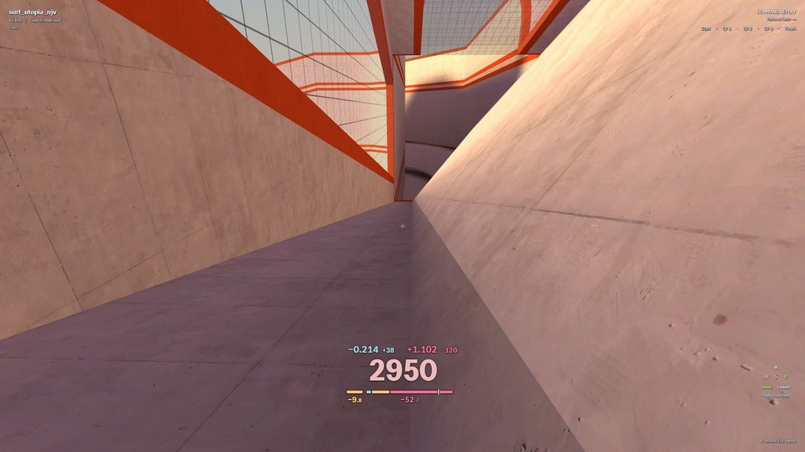
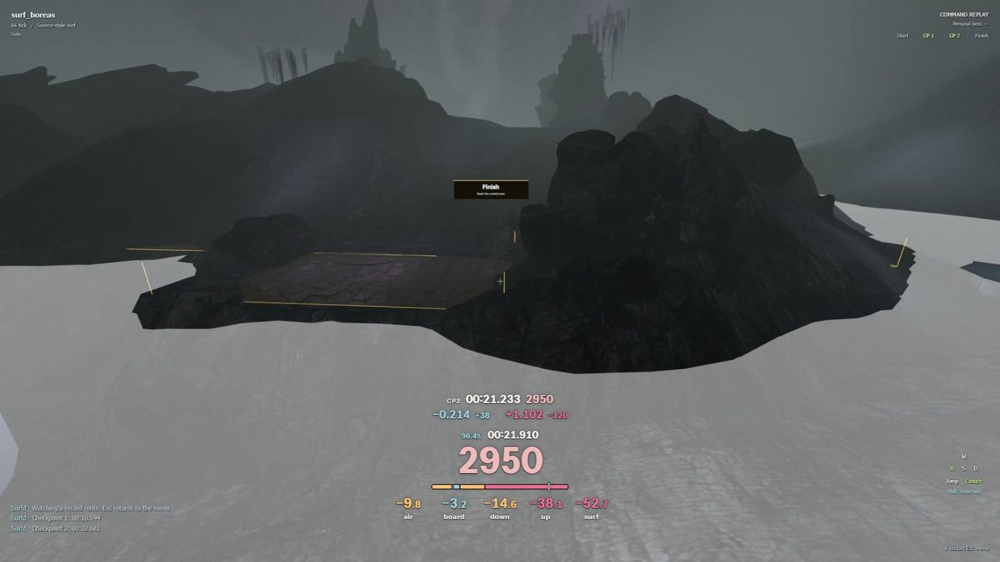

# Surfd QoL



*The compact HUD you surf with, just after a checkpoint. Replays and spectating show everything, and each part can be shown or hidden on its own.*

A browser extension for [surfd.net](https://surfd.net/) that shows where you lose speed, on each ramp and in the air, so you can find your mistakes and see what an optimal run does differently. It also adds start stats, PB and WR checkpoint splits, run history, replay controls, a crouch-jump bind and nullbinds.

Everything on the HUD can be configured or turned off. The code is plain JavaScript with no dependencies, so it's easy to change or extend yourself, or with your own coding agent. It never changes physics, maps or your runs: it watches the game's own movement code and reports what happened.

**Download page: [eduardr02.github.io/surfd-qol](https://eduardr02.github.io/surfd-qol/)**

## Install

You need a desktop Chromium browser: Chrome 118 or newer, Edge, Brave or Opera (Firefox isn't supported). The extension isn't on the Chrome Web Store, so you load it yourself:

1. Download [surfd-qol.zip](https://github.com/EduardR02/surfd-qol/releases/latest/download/surfd-qol.zip) and unzip it somewhere it can stay. Your browser loads the extension from that folder every time.
2. Open your browser's extensions page (`chrome://extensions`, `edge://extensions`, `brave://extensions` or `opera://extensions`) and switch on **Developer mode**.
3. Click **Load unpacked** and pick the unzipped folder (the one containing `manifest.json`).
4. Open [surfd.net](https://surfd.net/). The tab reloads once while the extension hooks in. Settings are under **QoL**, bottom right of the game menu, next to the notification bell. Changes save automatically.

**Updating:** when a new version is out, a link appears above **QoL** in the game menu. Download the new zip, replace the folder's contents, then click the reload icon on the extension on your browser's extensions page and reload Surfd. Your settings stay.

### About the "started debugging this browser" bar

Your browser shows this bar because the extension uses the debugger permission to patch the game script as it loads. That is the only way to reach the game's private physics objects. It only attaches to surfd.net's game page and only touches `assets/game-*.js`.

You can close the bar with × or **Cancel**. Everything already loaded keeps working, including the binds, until you reload the page. The toolbar badge shows **ON** when the extension is active on the page and **!** if setup failed or the bar was closed before setup finished. Click the toolbar button to reconnect; that reloads the tab, so do it between runs. The bar comes back after each reload.

## What you get

### The HUD

Speed sits big on the centre line of the screen, with a bar for your last ramp under it. Size, height, opacity and all colors are adjustable, and the HUD uses its own bundled font (Instrument Sans), so nothing is fetched from the web. It hides in menus, loading screens and dialogs, and stays up for replays and spectating.

**Two layouts.** While you surf, the HUD stays compact: the speed and the ramp bar with two values under it, and no timer (turn on **Timer** under **While surfing** if you want it). For a few seconds after the start and each checkpoint, your start stats or checkpoint deltas show above the speed. Run labels like PRACTICE or INVALID still show. Replays and spectating show the full HUD: the timer and strafe sync, each checkpoint's split, and every ramp value written out. Set **While surfing** to **Full** under **Display** to keep everything on while you run. **Zen** keeps just the speed and the start stats.

**The ramp bar** keeps one width, centred under the speed. Your last flight (AIR) and the ramp you landed on share it in the order they happened: the flight, then the touch, the rest of the way down and the way up, each part in the color of its grade. The tick marks where the ramp would have ended had it cost what the reference ramp did, so whatever lies right of it is what you lost beyond the reference. Beat the reference and your parts end early, with the tick at the bar's end. With fixed grading there's no reference, so there's no tick. While surfing, the two values under the bar are the flight's loss and what the ramp has cost you so far: its touch right after you land, then the whole ramp once you leave it. Turn off **Ramp bar** under **Display** to keep just the values.

The values, all in u/s. Each one stays until the next ramp or flight replaces it, so you can glance at it in the air instead of mid-ramp.

| Value | What it measures |
|---|---|
| **TOUCH** | Speed clipped off when you touch a ramp. Pure collision loss: height conversion doesn't count. Quick re-touches during the landing count as part of the same touch. It's also the first part of DOWN, so DOWN and SURF include it. |
| **DOWN** | What the ramp cost you on the way down, from the moment you touched it (so it includes the touch) to the lowest point you reached. |
| **UP** | What it cost you from the lowest point to where you left the ramp: the turn up and the exit. |
| **AIR** | Your last flight between ramps: speed lost to air braking plus gain missed by imperfect strafes. You can show either part on its own. |
| **SURF** | The whole ramp: DOWN + UP, touch included. It's the value under the bar while you surf. |

Down and Up are measured against perfect gravity-only conversion. If you land at 2500 u/s and leave lower or higher, the height change is converted back to speed before comparing, so climbing a ramp is never counted as a loss. **Down + Up equals the whole-ramp loss exactly, touch included.** Prefer one number per ramp in the full HUD? Set **Ramp result** to **Net** to show SURF instead of DOWN and UP.

Don't chase zero. Ramp surfing always bleeds some speed; on Cannonball's second ramp the KSF record still loses 34 u/s going down and 16 coming up. That's why the useful comparison is against a reference run, which is the default.

Turn any of them off and the bar and the values leave it out.

### Colors

Touch and the ramp values compare against the same ramp in a reference run, matched by ramp, checkpoint and visit:

- **teal**: as good as the reference or better
- **gold**: worse, but within the near-reference margin (2 u/s by default)
- **red**: worse than that
- **grey**: no matching data (reference still loading, different route, or no PB on this map)

The reference can be your PB replay or the WR. "WR" means the KSF record route (the site's "Watch the record route") by default, or Surfd's leaderboard #1. You can also switch any value to fixed cutoffs. Air always uses fixed cutoffs, since there's no meaningful per-flight reference.

A worse number is a measurement, not proof of a mistake. A different line or entry speed changes it too.

### Start

For 1.8 seconds after you leave the start zone you see your exit **speed** (350 is the airborne cap, 325 grounded) and your **height** above the start platform (lower is better; crouching doesn't fake it), where the checkpoint deltas go. While surfing, your strafe sync sits between them. Grade them against fixed targets, your PB or the WR.

### Checkpoints

At each checkpoint you get time and speed deltas against your PB, the WR, or both, for a few seconds; the full HUD also shows the split's own time and speed above them. The reference comes from the full replay, never per-checkpoint bests.



*The full HUD, as replays and spectating show it, just after a checkpoint.*

### Binds

- **Crouch-jump** (off by default; turn it on under **Controls**, Space unless you rebind it): holding jump presses crouch for exactly one physics tick per jump. That's enough for the crouched jump impulse (+6 u/s vertical, the same as holding crouch) without staying crouched. Rebind it to any free key.
- **Nullbinds** (off by default): for left/right and for forward/jump, the newest key you press wins, and releasing it hands control back to the other one if it's still held. They follow your Surfd key bindings, including alternate and mouse binds. Forward/jump cuts forward input while jump wins (not your momentum) and blocks jump while forward wins.

Both work inside the game's own input sampling, so the commands it records are exactly what you'd get from a keyboard that did this in hardware. Your binds on disk aren't changed.

### Strafe preview

Not sure how fast to turn? Stand still in the start zone, open **QoL → Controls**, enter a speed in u/s, pick **Ground** (the prestrafe) or **Air**, and press **Start**. Your view turns the way a good strafe would: alternating strokes at the best turn rate for your speed, while the speed grows as perfect strafing would grow it. The HUD shows which of A or D you'd hold, the speed and the turn rate. Any key, mouse button or mouse movement stops it and puts your view back. It only moves the camera: no keys are pressed and you don't move.

### Run history

**Runs**, next to **QoL** in the menu, opens on the map you're on; pick another map from the title.

- **Runs:** your leaderboard PB, or your best recorded finish if no PB is available. Watch it with ▶. Alongside are your best and average start speed, attempt and finish counts, and best checkpoint times compared with that finish. Below are your latest attempt and recent runs, with a replay for each. **Recent best** keeps your fastest retained finish from the last 24 hours.
- **Ramps:** one row per ramp answers where you lose speed: how many of your runs reach it, and one measurement against your PB or the WR, with a bar on one scale for the map so the costliest ramps stand out; a ramp far past the rest runs off the end of the bar with a break. Pick the measurement (Surf, Touch, Angle, Down, Up, speed In or Out; it's remembered) and switch between your best, last 10 measurements and average. Click a ramp to open it: Touch with its **angle** (how far your landing was from parallel to the ramp, so 0° loses no speed on touch), Surf with Down and Up, and your speed in and as you left the ramp, each next to the reference, plus buttons to watch the ramp in your PB, the WR or your recent best, paused half a second before the touch. If that route skips the ramp, it isn’t available. Reach, angle and speeds count normal timed attempts only. Runs that crash into a ramp's edge or a wall are left out of its last 10 and average, and an open ramp says how many. Angle counts as near within 0.5°. Reset averages separately without losing bests or replays.

Bests count clean recorded runs, including ones you reset. Practice and invalid runs don't count. Short resets don't fill up your recent history, but your latest attempt is always available.

The average start leaves out clipped starts, where you landed back in the start zone after your jump, so the game blocked the next hop and you left on the ground. Averages from earlier versions included them, so each map’s average starts over at its next clean start.

The last 10 count measurements of each ramp, not your last 10 runs. Averages start collecting when you update; old recordings aren’t re-analysed. Recent best uses your existing replay allowance, not extra storage.

### Watching replays

▶ in Runs plays a recording with the full HUD, including the prestrafe. Surfd’s own player handles playback, seeking and indexing for your recordings, leaderboard runs, the record route and server replays.

By default, the extension adds Saveloc, Runs and saved-location marks to the game’s replay bar. Ramp touches are marked on the timeline, coloured like the HUD: your recorded runs have them from the moment you surfed them, and any other replay (your PB, the WR, the leaderboard) gets them a moment after the game has indexed it. Each replay is analysed once and remembered. Playback shortcuts stay the game’s own, so each press acts once.

**Savelocs:** click **Saveloc** or use your usual Save position bind to bookmark a moment. Your saved moments become practice savelocs when you leave the replay, so you can load them and try the section yourself. Loading one keeps the start position you set.

Prefer the extension’s timeline? Enable **QoL → History → Custom replay bar**. It has the same touch marks and savelocs, drives the same native player, and you can switch while watching. Recording is separate.

Seeking to an unvisited section can leave feedback grey: the game’s keyframe has movement state, but not the extension’s analysis of the earlier ramp or flight. Incomplete segments are excluded rather than shown as complete measurements.

### Runs alongside a replay

While you watch any replay, **Add run** on the replay bar plays another run of the map beside it: your PB, your recent best, the site WR, the KSF WR, or any run on the leaderboard (find one by name or rank). Add up to four. Each plays as a ghost with its line through the map, from a third-person camera, and the replay bar, speeds, seeking and stage jumps keep working as usual.

- The row above the replay bar lists each run with its time and how far this run is behind (red) or ahead (teal) of it at this point. × takes a run out; without any, the replay goes back to first person.
- **Real time** (the default) races the runs on the clock. **Side by side** keeps them at the same place on the route instead: the faster runs are slowed down, so you see where the lines differ.
- The camera is planned for the whole replay before it plays. It sits behind the ghosts and swings towards the open side of the ramp they surf, so you look onto the ramp rather than through it, pulls back with speed and in the air, and turns or comes closer before walls get in the way. It cuts at teleports.
- Each run keeps its colour when another is removed. Its line has a soft comet tail and a quieter preview ahead; the streaks follow replay time, so pausing freezes them and seeking restores them.
- **Drag** the view to look from another angle and **scroll** to move closer or further; **Reset view** or a double-click goes back to the planned camera.
- With runs alongside, the timeline's touches and saved locations step aside and Saveloc is off: they belong to this run alone.

Adding a run re-simulates it and takes a second or two. Nothing runs until you add one.

### What's kept

Under **QoL → History** you can turn recording off, choose how many recent runs to keep per map and set the minimum reset length. Each run includes its replay. Your best recorded finish, best splits and ramp bests stay even after older attempts are removed.

Everything is stored in this browser. The same page shows storage use and has **Clear all**.

### Replays and spectating

Replays get full feedback, plus a **Hull: crouched / standing** line in the game's key display, so you can see when the player is surfing crouched after letting go of crouch. Spectating shows speed, time and checkpoint progress only, since network updates don't carry enough data for exact feedback. Energy tint is also unavailable while spectating: interpolated network poses can look like gains or losses even during a physically neutral arc. The setting still applies to your own runs and locally simulated replays.

### Private rooms

Surf with friends in a room of your own: no time limit, no map votes, and the host picks the map. Everyone in the room needs Surfd QoL.

- **Host:** open **Find a server** and click **Host a room**. Pick a map, a name, a player limit, and **Private** (room code or invite link only) or **Public** (listed under **Community** for everyone with the extension). Hosting needs a surfd.net account. Your browser runs the room, so keep the tab open; the room view shows the upload your player limit needs.
- **Join:** pick a room in the **Community** tab, type its code next to the filters, or open an invite link.
- **In the room:** chat, spectating, map changes and finished runs work like on Surfd's servers. Runs count for the leaderboard as they do in solo play: Surfd checks each replay itself.
- **Shared savelocs:** a location anyone saves shows up in everyone's saveloc list (Settings → Gameplay), labelled with its owner. Everyone keeps up to 20 per map, as in the game.

### Optional extras

- **Live feedback** (off by default): a row of values that update continuously instead of the ramp bar. Meant for watching replays, not for runs.
- **Tint speed by energy** (experimental, off by default): the speed number turns a vivid red (its own, brighter than the HUD's usual red) while you lose units and keeps its colour while you gain or hold them (surfing gains a little almost all the time, so only losses are worth flagging). It tracks speed and height together, so falling or climbing doesn't count, only strafe gains, braking, clips and friction do. Ramps are excluded unless you enable **Include ramps**, because surfing a ramp always bleeds some energy and would read red almost all the time. The colour follows a short average (about a tenth of a second), so it shows whether you're losing overall. **Per tick** drops the averaging and the fade instead: each tick's own loss shows, such as the brief one as you switch from A to D in a prestrafe. It flickers, and the Speed refresh rate has to be above 66 fps to show every tick.

## Is it safe for ranked runs?

The extension doesn't change physics, collision, timing or replays, and it doesn't submit anything. The binds change which keys count as pressed, just like keyboard software would; the result is recorded in your replay as normal input. Whether the leaderboard accepts runs made with binds is up to Surfd; see [Surfd's terms](https://surfd.net/terms.html).

## Performance and privacy

- Hidden feedback skips its analysis. PB/WR comparisons share saved results rather than analysing the same replay repeatedly.
- The speed counter updates at 60 FPS and the timer at 30 FPS by default, so digits stay readable. You can change both; the game itself stays uncapped.
- No telemetry. Settings and recordings stay in your browser. The extension downloads reference replays from surfd.net and checks GitHub for updates at most once a day, without sending your runs or settings.
- Private rooms use a small room service on Cloudflare to list rooms and connect players, only while the main menu or Find a server is open, you host, or you are in a room. Game traffic between players goes through Cloudflare's relay, not directly between computers.

## Troubleshooting

- **No custom HUD:** check the badge. **!** means setup failed; click the toolbar button to reload. If Surfd shipped an update the extension doesn't recognise, it stays out of the way and the game's own HUD remains.
- **Everything grey:** the reference is still loading, you have no PB on this map, or your route visits ramps in a different order than the reference.
- **A value shows —:** nothing measured yet this run, the contact was ambiguous (e.g. ramp and wall at once), or the value was hidden for part of that ramp or flight. Flights with under 50 ms of strafing don't replace the previous AIR value at all.
- **The debugger bar keeps coming back:** expected after every reload; see above.

## Development

You only need [Bun](https://bun.sh) to work on the source; no other dependencies.

```sh
bun run build   # writes the unpacked extension to dist/
bun test
```

Load `dist/` with **Load unpacked** while developing. To publish a release, bump `version` in `extension/manifest.json`, commit, then push a matching tag (`git tag v1.0.1 && git push origin v1.0.1`). The release workflow tests, builds and attaches `surfd-qol.zip` to a GitHub release, which the download links always point at. The download page lives in `docs/` and is served by GitHub Pages; `dev/` has a harness for rendering HUD states (see `dev/README.md`).

Source layout:

- `extension/`: manifest, the background loader (debugger attach and script patching) and `instrument.js`, which appends an adapter to the game module.
- `src/metrics.js`: per-tick movement analysis (Touch, Down/Up/Surf, Air, live feedback).
- `src/observer.js`: wraps the game's movement methods without changing their results.
- `src/hud-model.js`: decides what the HUD shows; `src/hud.js` renders it and the settings panel.
- `src/strafe-preview.js`, `src/strafe-preview-ui.js`: the strafe preview and its indicator.
- `src/energy.js`: the speed tint's energy trend.
- `src/references.js`, `src/run-references.js`, `src/replay-store.js`: PB/WR replay download, native re-simulation and ramp matching.
- `src/run-history.js`, `src/runs-panel.js`, `src/ramp-reference.js`: recent runs and per-map bests, the Runs panel, and PB/WR ramp values to compare against.
- `src/replay-archive.js`, `src/replay-trim.js`: saved replays (compressed, in IndexedDB), trimmed to a few seconds before the start.
- `src/replay-control.js`, `src/replay-frames.js`, `src/replay-bar.js`, `src/native-replay-ui.js`: native-player integration, bounded analysis checkpoints, replay savelocs and the native/custom replay bars.
- `src/start.js`, `src/bindings.js`, `src/settings.js`, `src/visibility.js`: start stats, binds, settings schema and HUD visibility rules.

## License

[MIT](LICENSE). The bundled HUD font, Instrument Sans, is under the [SIL Open Font License 1.1](docs/fonts/OFL.txt).
